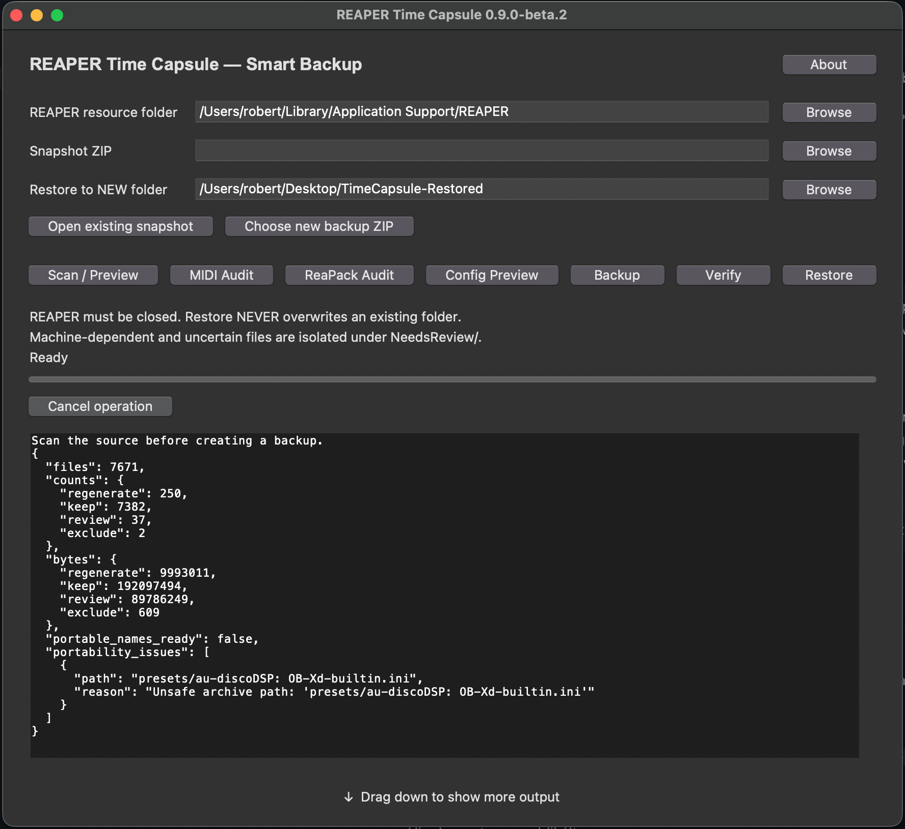
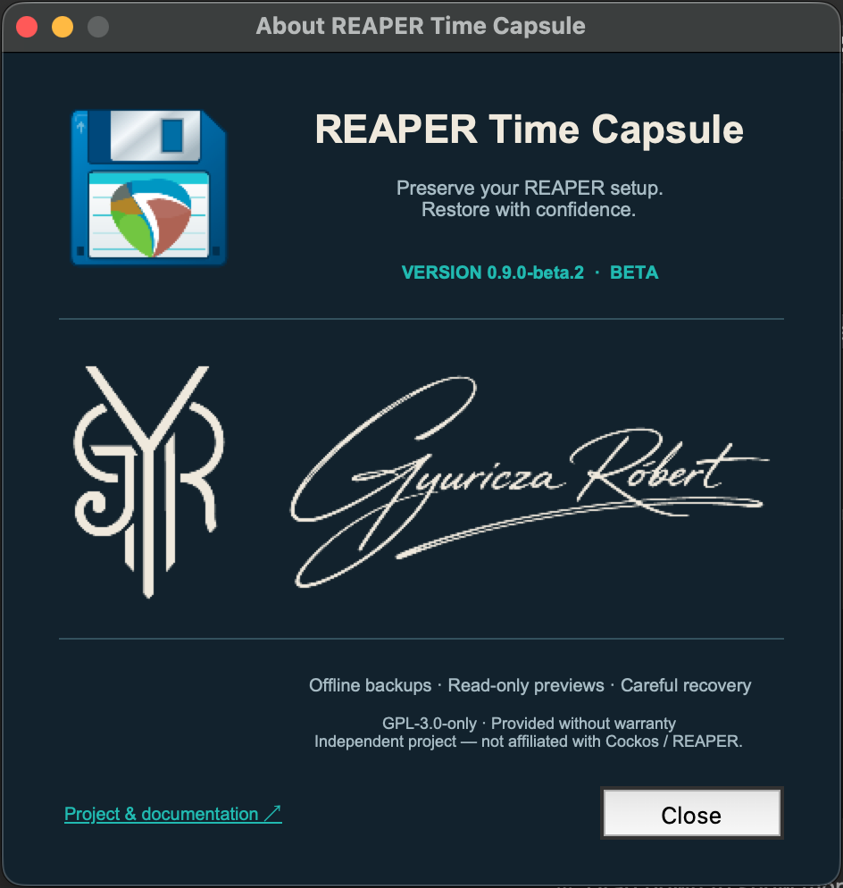

# REAPER Time Capsule

Hivatalos alkalmazásnév: **REAPER Time Capsule**. A fejlesztői build már ezt
használja; a lent hivatkozott publikált bétafájlok eredeti neve megmarad.
[Az audit ellenőrzése és a javítási sorrend](docs/AUDIT_REVIEW_2026-10-11.md).

**Őrizd meg a REAPER-beállításaidat. Állítsd vissza őket biztonsággal.**

Nyílt forráskódú eszköz a REAPER erőforrásainak offline mentéséhez, a mentések
ellenőrzéséhez és másik gépen történő körültekintő visszaállításához. Együtt őrzi
meg a hordozható fájlokat, és elkülöníti a kézi felülvizsgálatot igénylő beállításokat.

[English](README.md)



*A projekt tulajdonosa által készített valódi macOS-képernyőkép, 2026. október 11.
A Scan / Preview egy fájlnév hordozhatósági problémáját jelzi; nem befejezett mentést mutat.*



*A fejlesztői build About ablaka az új floppy ikonnal, GYR-logóval és grafikus szignóval. Ezek a felületi változtatások még nem szerepelnek a publikált béta letöltésében.*

> **[0.9.0-beta.2 letöltése](https://github.com/RobCZart82/REAPER-TimeCapsule/releases/tag/v0.9.0-beta.2)**
> — nyilvános, aláíratlan béta. Az eszköz erőforrásokat ment és állít vissza;
> a teljes, egykattintásos REAPER-újratelepítés még nincs megvalósítva. Tarts külön biztonsági mentést is.

## Letöltés

A csomagokat a projekt [GitHub Releases](https://github.com/RobCZart82/REAPER-TimeCapsule/releases) oldaláról töltsd le.

| Platform | Alkalmazás |
|---|---|
| macOS · Apple Silicon (arm64) | [Aláíratlan alkalmazás ZIP](https://github.com/RobCZart82/REAPER-TimeCapsule/releases/download/v0.9.0-beta.2/REAPER-TimeCapsule-0.9.0-beta.2-Darwin-arm64-unsigned.zip) |
| Windows · x64 | [Aláíratlan alkalmazás ZIP](https://github.com/RobCZart82/REAPER-TimeCapsule/releases/download/v0.9.0-beta.2/REAPER-TimeCapsule-0.9.0-beta.2-Windows-AMD64-unsigned.zip) |
| Linux | [Forráskód és kiadási megjegyzések](https://github.com/RobCZart82/REAPER-TimeCapsule/releases/tag/v0.9.0-beta.2) · Python 3.10+ |

Mindkét alkalmazás ZIP tartalmazza a hozzá tartozó forráskódot, a GPL és a futtatókörnyezet
licencszövegeit, a csomagolt alkalmazás öntesztjének jelentését és a dokumentációt.
A kiadáshoz [SHA-256 ellenőrzőösszegek](https://github.com/RobCZart82/REAPER-TimeCapsule/releases/download/v0.9.0-beta.2/SHA256SUMS.txt)
és platformonkénti buildleírások is tartoznak. A Windows-forrás CRLF sorvégeket használ.
A `main` ágon folyó fejlesztés eltérhet a már kiadott csomagoktól.


### Fejlesztés: bejárási és célútvonal-védelem

A könyvtárbejárási és fájlmetaadat-olvasási hibák megszakítják a felmérést/mentést;
a hibás felmérésből nem készül sikeresként publikált archívum. A szimbolikus linkek,
Windows reparse pontok és speciális elemek kihagyásként szerepelnek a
`skipped_entries` jelentésben és a manifest kihagyott listájában. Célpontjukat nem
követjük vagy másoljuk; a nulla méret azt jelenti, hogy a cél tartalmát nem mértük
fel. Ezeket a kihagyásokat ellenőrizd, mielőtt a mentésre hagyatkozol.

A mentés feloldja és rögzíti a tényleges célmappát, elutasítja a forrásba vezető
aliasokat, és az exkluzív publikálás előtt újra ellenőrzi a célmappát. Ez nem
tranzakciós fájlrendszer-pillanatkép vagy védelem tetszőleges ellenséges
könyvtárcserével szemben. A leltár konzisztenciája és az olvasók útvonalhatárai
külön javítások maradnak. Ezek a változások a main ágon vannak, nem a publikált bétában.

### Fejlesztés: archivált leltár és restore-előnézet

Az új mentések ReaPack/MIDI-leltára a ZIP-be írt pontos bájtok ideiglenes,
elkülönített másolataiból készül, nem későbbi élő forrásolvasásból. A másolatok
siker, megszakítás vagy kezelt hiba után törlődnek. A parser méretkorlátja miatt
nem elemzett bemeneteket jelezzük; az eredeti erőforrás az archívumban megmarad.
Ez további ideiglenes tárhelyet igényel a korlátozott méretű parserbemenetekhez,
és nem egyidejű fájlrendszer-pillanatkép.

A leltár és az erőforrás-alapú ReaPack/MIDI-audit elutasítja a linkelt szülőutakat.
A restore-előnézet az aktuális szabályokat, a tárolt darabszámokat és az indokolt
besorolásváltozásokat mutatja. A régi leltárak forrásalapját ellenőrizetlenként
jelöljük; az eredeti fájlok megmaradnak, és az aktuális restore-védelem érvényesül.
Ezek a változások a main ágon vannak, még nem a publikált bétában.

## Funkciók

- Fájlszabályok sorolják az erőforrásokat `keep`, `review`, `regenerate` vagy `exclude` kategóriába.
- A mentés megőrzi a hordozható Scripts, MenuSets, KeyMaps, LangPack és eszköztár-erőforrásokat,
  témákat, felhasználói preseteket, SWS-konfigurációt és a kiválasztott ReaPack-állapotot.
- A ZIP jegyzéke SHA-256 hashértékeket, kihagyási döntéseket és platformadatokat rögzít;
  az ellenőrzés minden archivált fájlt vizsgál.
- A visszaállítás új, külső mappát hoz létre: a hordozható erőforrások a `REAPER/`,
  a bizonytalan konfigurációk és natív kiegészítők a `NeedsReview/` mappába kerülnek.
- A háttérben futó Backup, Verify és Restore fázisonként mutatja az előrehaladást,
  és biztonságos pontokon megszakítható a Cancel gombbal. Egyszerre egy művelet fut;
  bezárás előtt meg kell várni a befejezést vagy a takarítást.
- A statikus MIDI Audit összeveti a menük Custom Action hivatkozásait a keymapekkel
  és a `reaper-kb.ini` fájllal; jelzi a hiányzó műveleteket és scriptfájlokat, illetve a nem hordozható scriptútvonalakat.
- A ReaPack 1.x audit kiolvassa a repositoryk nevét, sorrendjét, URL-jét, engedélyezési
  állapotát, egyedi automatikus telepítési felülbírálásait és globális beállításait.
  A telepített csomagok, verziók és rögzített verziók leltára csak olvasással készül az SQLite-nyilvántartásból.
- A konfiguráció- és témaelőkép csak olvasással azonosít jelölteket és ütközéseket;
  a kifejezetten kiválasztott preferenciák külön, felülvizsgálható adatként exportálhatók.

A `main` ágon az ablak minden indításkor a jóváhagyott, gombsorhoz méretezett
alapméretben nyílik meg, és nem menti az átméretezést. Mindkét irányban méretezhető;
a minimális szélesség láthatóan tartja a gombsort. Közös oszlopok igazítják az
útvonalmezőket és a Browse gombokat. A kimeneti sorok nem tördelődnek; a vízszintes
és függőleges görgetősáv csak szükség esetén jelenik meg. Az alsó ↓ fogantyú
a jelenlegi szélesség megtartásával növeli a kiírás területét. Ezek az elrendezési
változások még nincsenek benne a publikált 0.9.0-beta.2 csomagokban. A main ágon
floppy alkalmazásikon is készül a REAPER jelével, valamint nem modális About ablak
a készítő GYR-logójával és kézírásos szignójával, szöveges polgári név nélkül.

## Rendszerkövetelmények

A macOS- és Windows-alkalmazáshoz nem szükséges Python vagy fordítóprogram.
A kiadott binárisok Apple Silicon, illetve Windows x64 gépekre készültek; Intel
macOS és Windows ARM kompatibilitást nem állítunk. Linuxon a forráskód használható.
A minimális operációsrendszer-verzió és a tiszta gépes működés még nincs teljesen
ellenőrizve; a tényleges buildkörnyezetet az [első béta útmutatója](docs/FIRST_BETA.md)
és a kiadás buildleírásai rögzítik.

A forrásból futtatáshoz Python 3.10+, a grafikus felülethez Tkinter/Tk is szükséges.
Mentés előtt zárd be a REAPER-t, és a művelet alatt ne változtasd a forrásfájlokat.
Hordozható REAPER-telepítésnél annak saját erőforrásútvonalát kell megadnod.

## Telepítés és első mentés

1. Töltsd le a platformodhoz tartozó ZIP-et, és bontsd ki a teljes csomagot.
   Az alkalmazás kísérőfájljait tartsd együtt. macOS-en indítsd a mellékelt `.app`-ot,
   Windowson az alkalmazásmappában található `REAPER-TimeCapsule.exe` fájlt.
2. Zárd be a REAPER-t. Az erőforrásútvonalat megnyitó REAPER-menüből keresd meg
   az erőforrásmappát, és válaszd ki azt a Time Capsule-ban.
3. Használd a **Scan / Preview**, majd a **Choose new backup ZIP** gombot; válassz
   új archívumot az erőforrásmappán kívül. A **Backup** után várd meg az ellenőrzést.
4. Az **Open existing snapshot** és **Verify** gombbal ellenőrizhetsz korábbi mentést.
5. Válassz még nem létező visszaállítási mappát, majd **Restore**. Kézi importálás
   előtt vizsgáld át a `REAPER/`, `NeedsReview/` mappákat és a jelentéseket.

A csomagok nem rendelkeznek fejlesztői tanúsítvánnyal vagy notarizációval.
A Gatekeeper vagy a SmartScreen figyelmeztethet. Ellenőrizd a hivatalos letöltést
és az ellenőrzőösszeget; ne kapcsold ki globálisan a rendszer védelmét.
Lásd a [béta útmutatóját](docs/FIRST_BETA.md).

## Konfiguráció- és témaelőkép

A grafikus **Config Preview** és a parancssori `config-preview` kifejezetten
kiválasztott INI-fájlokat hasonlít össze, és érzékeny adatoktól megtisztított
eltérésjelentést készít. Csak pontosan jóváhagyott szakasz-, kulcs- és értékkombinációk
lehetnek jelöltek; az ismeretlen kulcsok felülvizsgálatot igényelnek, a hardver-,
platform-, plugincache- és privát állapotadatok kizártak. A bemenetek és az aktív
REAPER-erőforrásmappa változatlanok maradnak. Aktív összefésülés nincs megvalósítva.

A `theme-preview` forrás-, gyári és cél-ColorThemes mappákat hasonlít össze:
azonosítja a bájtszinten egyező csomagolt gyári témákat, módosított változatokat,
felhasználói témákat és céloldali ütközéseket. Nem másol, töröl vagy hagy ki mentési fájlokat.

A `config-stage` kifejezett engedélyezést, verzióadatokat és pontos preferenciakijelölést
igényel. Új `.timecapsule-stage.zip` fájlt készít egy elkülönített, külső
`TimeCapsule-Staging` mappában. Preferenciaadatokat, visszafelé mutató értékeket
és ujjlenyomatokat tartalmaz, nem telepíthető `reaper.ini` fájlt. A `verify-stage`
az integritást, a jóváhagyási szabályokat és opcionálisan a cél kiinduló állapotát
ellenőrzi. Egyik parancs sem alkalmaz beállításokat vagy biztosít teljes visszagörgetést.

## Biztonság és korlátok

A visszaállítás nem ír felül létező célmappát és nem olvaszt fájlokat az aktív
REAPER-mappába. A régi VST/AU/CLAP-vizsgálati cache-ek és letöltött ReaPack-indexek
újragenerálandók; a régi telepítettcsomag-nyilvántartás a `NeedsReview/` alá kerül.
A Time Capsule nem szinkronizál ReaPackot, nem módosítja annak nyilvántartását,
nem telepít plugint vagy natív kiegészítőt, nem visz át licenceket és nem tölt le automatikusan összetevőket.

A regisztrációs/licencfájlok és nyilvánvaló hitelesítő adatok alapértelmezetten
kimaradnak a mentésből. A leltárjelentések kitakarják a felismerhető repository-URL-ek
hitelesítő adatait; az eredeti mentett konfiguráció ettől még privát lehet.
Tartsd privátan az archívumaidat, és ne csatolj teljes profilt vagy hitelesítő adatot nyilvános hibajegyhez.

A mentéshez írható, hard linket vagy natív kizárólagos átnevezést támogató tárhely
szükséges. A nem támogatott kötetek biztonságosan hibával leállnak; valódi FAT/exFAT-teszt még szükséges. A visszaállításhoz kizárólagos átnevezés támogatása kell.
A Windows alatt érvénytelen neveket, kis-/nagybetűs vagy Unicode-ütközéseket és
fájl/mappa-konfliktusokat minden platformon elutasítja átnevezés vagy kihagyás helyett.
A Scan / Preview elfogadja a natív neveket (például a macOS kettőspontos AU-presetneveit),
és útvonallal együtt jelzi a hordozhatósági problémákat. Az érintett fájlok a listában
maradnak; a hordozható mentés az archívum létrehozása előtt leáll. Nincs csendes
kihagyás vagy átnevezés.

A megszakítás biztonságos ellenőrzési pontokra vár, és a végső közzététel után is
érkezhet; a már elkészült eredményt sikeresként jelzi. Az előrehaladás fázisonkénti,
nem teljes százalék vagy időbecslés. Az auditok és más felmérések szinkron módon futnak.
Nincs teljes tranzakciós pillanatkép, áramkimaradás elleni tartóssági vagy rosszindulatú
fájlrendszerverseny elleni garancia; a szokatlan fájlrendszerek és útvonalhossz-korlátok további ellenőrzést igényelnek.

A statikus audit és sikeres CI nem igazolja minden script, téma, kiegészítő vagy
MIDI-munkafolyamat működését a REAPER-ben. Tarts külön biztonsági mentést,
és a visszaállítás eredményét friss REAPER-telepítésben vizsgáld át.

## Dokumentáció

- [Első béta útmutatója és csomagkorlátok](docs/FIRST_BETA.md)
- [Mentési szabályok](docs/REAPER_BACKUP_POLICY.md)
- [Konfigurációmigráció előképe](docs/CONFIGURATION_MIGRATION.md)
- [Preferenciaexport és ellenőrzés](docs/CONFIGURATION_STAGING.md)
- [Témamigráció előképe](docs/THEME_MIGRATION.md)
- [MIDI Workflow Recovery](docs/MIDI_WORKFLOW_RECOVERY.md)
- [ReaPack Smart Recovery](docs/REAPACK_SMART_RECOVERY.md)
- [Kiadási felkészültség](docs/RELEASE_READINESS.md) és [fejlesztési útiterv](docs/ROADMAP.md)

A részletes technikai dokumentumok jelenleg angol nyelvűek. Ez a README és
[angol párja](README.md) ugyanazokat a funkciókat, útmutatásokat és korlátokat ismerteti.

## Futtatás forrásból

A kibontott forráskönyvtárból indítsd a grafikus felületet vagy használd a parancssort:

```bash
python -m reaper_timecapsule gui
python -m reaper_timecapsule scan
python -m reaper_timecapsule midi-audit
python -m reaper_timecapsule reapack-audit
python -m reaper_timecapsule backup my-timecapsule.zip --source /path/to/REAPER
python -m reaper_timecapsule verify my-timecapsule.zip
python -m reaper_timecapsule restore my-timecapsule.zip RecoveredTimeCapsule
```

A `scan`, `midi-audit` és `reapack-audit` opcionális forrásmappát fogad el.
Enélkül a platform alapértelmezett REAPER-erőforrásútvonalát vizsgálja.
Hordozható telepítésnél adj meg kifejezett útvonalat. Előkép- és exportpéldák:

```bash
python -m reaper_timecapsule config-preview old.ini clean.ini --source-version 7.82 --target-version 7.82
python -m reaper_timecapsule theme-preview old/ColorThemes factory/ColorThemes clean/ColorThemes --source-version 7.82 --factory-version 7.82
python -m reaper_timecapsule config-stage old.ini clean.ini TimeCapsule-Staging/review.timecapsule-stage.zip --select REAPER/tinttcp --source-version 7.82 --target-version 7.82 --opt-in
python -m reaper_timecapsule verify-stage TimeCapsule-Staging/review.timecapsule-stage.zip --target clean.ini
```

A fenti útvonalak és REAPER-verziók példák; a ténylegesen kiválasztott bemeneteidet add meg.
Az automatikus tesztek parancsa: `python -m unittest discover -s tests -v`.
A kiadás 112 tesztje sikeres macOS, Windows és Linux alatt Python 3.10/3.12-vel;
mindkét csomagolt alkalmazás teljesítette a szintetikus mentési/ellenőrzési/visszaállítási
és Tk-indítási próbákat. Ez nem helyettesíti a teljes REAPER-integráció tesztelését.

## Névjegy és licenc

Fejlesztő: **RobCZart82**. Hibát a [GitHub Issues](https://github.com/RobCZart82/REAPER-TimeCapsule/issues)
oldalon jelezz, a verzióval, operációs rendszerrel, architektúrával és reprodukciós
lépésekkel, csökkentett vagy szintetikus példák használatával.

A Time Capsule forráskódja [GPL-3.0-only](LICENSE) licencű, garancia nélkül.
A csomagolt futtatókörnyezetek saját feltételeiket őrzik; lásd a [külső összetevők megjegyzéseit](THIRD_PARTY_NOTICES.md).
A projekt nem terjeszt REAPER-t, saját tulajdonú plugineket, külső scriptcsomagokat,
személyes profilokat vagy regisztrációs kulcsokat. Nem áll kapcsolatban a Cockos / REAPER-rel,
és nem rendelkezik annak hivatalos támogatásával.

A MIDI Audit már jelzi a duplikált/ütköző definíciókat, függőségi ciklusokat és ellenőrizetlen numerikus parancsokat. Egy menühivatkozás feloldása nem igazolja a műveletlánc REAPER-beli működését. Hiteles futásidejű műveletkatalógus nélkül a numerikus parancsok ellenőrizetlenek maradnak.

A fejlesztői verzióban a Scan / Preview, MIDI Audit és ReaPack Audit közös háttérfeldolgozóban fut: a felület válaszképes marad, és a műveletek együttműködően megszakíthatók. A csak olvasó ReaPack SQL-elemzés öt másodperces lekérdezési keretet kapott; túllépéskor külön `timed-out` állapotot jelez. A megszakítás megvárhat egy folyamatban lévő rendszeroldali fájlolvasást; nem kényszerített szálleállítás.

A natív fájlnevek, például a macOS kettőspontos nevei, külön választható, 3-as sémájú mentésben megőrizhetők. Az eredeti nevű visszaállítás azonos platformot követel; a választható hordozható kinyerés minden fájlt elkülönít, és visszafejthető névleképezést rögzít. A parancsok, a GUI jóváhagyása és a kompatibilitási korlátok a [natív fájlnév-visszaállítás](docs/NATIVE_FILENAMES.md) leírásában találhatók.

A mentés és visszaállítás előkészítése most konzervatív szabadhely-becslést ellenőriz. A ZIP-vizsgálat még a jegyzék betöltése előtt korlátozza annak bájtméretét és bejegyzésszámát; a ZIP64 továbbra is támogatott. A csak olvasó `staging-residues SZÜLŐMAPPA` tartalomolvasás és törlés nélkül listázza az esetleges összeomlási maradványokat. Lásd az [erőforráskorlátokat](docs/RESOURCE_BUDGETS.md).

A visszaállítási útvonalakat még az előkészítés előtt konzervatív fájlrendszerkorlátokhoz ellenőrizzük. Az eredeti időbélyegek és jogosultságok tájékoztató metaadatként mentődnek; a visszaállítás nem aktivál futtatási jogosultságot, és nem másol ACL-t vagy kiterjesztett attribútumot. Lásd a [fájlrendszeres közzétételt](docs/FILESYSTEM_PUBLICATION.md).

A Scan / Preview után a **File policies…** gomb csak olvasó, kereshető szabálylistát nyit, laponként 200 sorral. A szűrés és a külön kérhető privát JSON-export háttérben fut. A jelentés megőrzi a vizsgálat eredetét, teljességét, szabályindokait, hordozhatósági problémáit és kézi lépéseit; helyi magánadat, nem az élő profil tranzakciós pillanatképének bizonyítéka.
